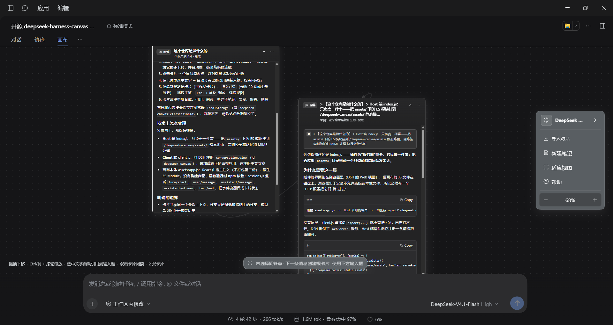
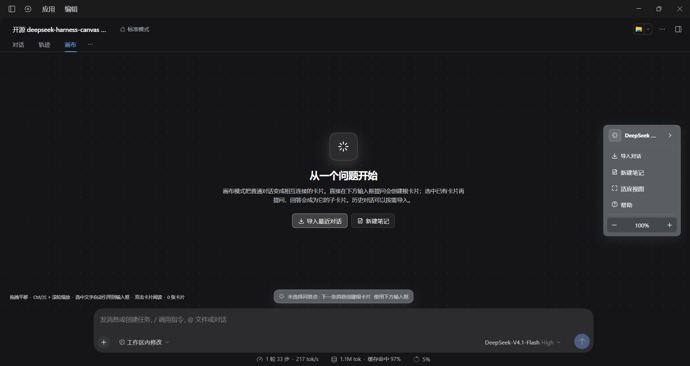
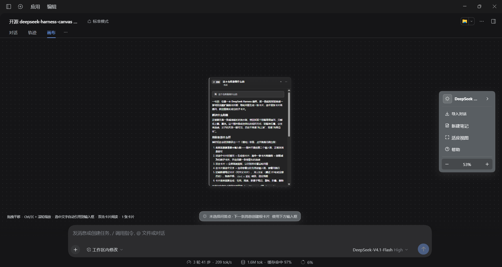
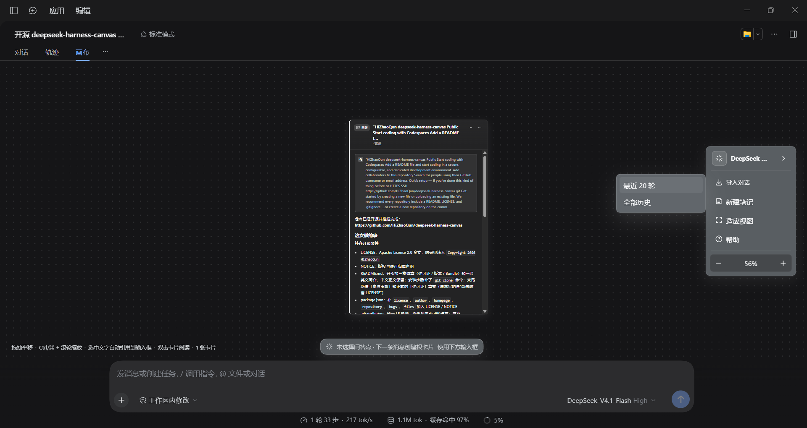
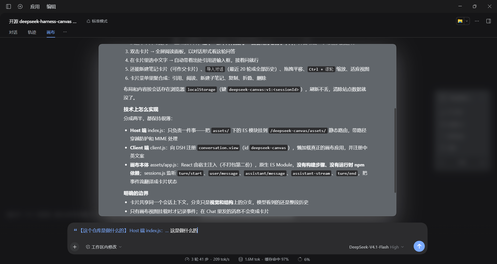

# DeepSeek Harness 画布插件

[](LICENSE)
[](package.json)
[](package.json)

DeepSeek Harness Canvas 是一个将普通对话变成无限卡片树的 DeepSeek Harness 插件。

它不提供第二个输入框：底部原有的 Harness 输入框是唯一入口，每一轮对话都会生成一张卡片。选中一张卡片后继续提问，新回答会成为该卡片的子卡片，从而形成可继续生长的问答树。

> **English** — DeepSeek Harness Canvas is an open-source plugin for DeepSeek Harness that turns every conversation turn into a card on an infinite canvas. Select a card, ask again, and the answer becomes its child card, so a session grows into a browsable question-answer tree. It ships as a self-contained DSH bundle written in plain ES modules: no build step, no runtime npm dependencies, and no CDN. Licensed under the [Apache License 2.0](LICENSE). Chinese documentation follows; see [安装](#安装) and [开发](#开发) for setup and development.

> 当前版本：`1.0.0`，第一版公开版本。



## 功能

- **对话即画布**：`画布` 是当前会话的另一种视图，不是独立会话。
- **每轮生成卡片**：发送消息后先创建等待卡片，智能体回答写入该卡片。
- **父子卡片**：选中父卡片再提问，回答自动成为子卡片，并绘制连接线。
- **选中文字引用**：先选中卡片，再在卡片或阅读面板中选中文字，会自动把引用插入底部输入框。
- **全屏阅读**：双击卡片打开居中阅读面板，以对话形式展示问题和回答。
- **记住阅读位置**：每张卡片的卡片内滚动位置和全屏阅读位置会分别记住，折叠卡片、切换视图或刷新页面后从上次停下的地方继续阅读；首次全屏阅读会从卡片当前的相对位置接着读。
- **全部折叠**：一键折叠或展开所有卡片，默认折叠；折叠卡片是 4:3 瓦片，显示标题和内容预览，不渲染流式回答，长对话时画面更流畅。
- **两种卡片尺寸**：折叠卡是 4:3 标题+预览瓦片（`472 × 354`）；展开卡是最大尺寸（`1008 × 772`，即两倍折叠宽/高加上对应方向的卡片间隙），正好占 2×2 个槽位，正文在卡片内完整滚动。两种状态可以在同一画布共存，展开时会自动找到最近的空 2×2 槽位。
- **网格磁吸**：画布预先铺好均匀的卡片槽位（间隙 64px）；新卡片自动填入最近空位。拖动卡片时会显示槽位轮廓，并按卡片当前尺寸高亮最近的磁吸目标，松手后吸附过去。可以随时关闭磁吸恢复自由摆放；打开开关时会把现有卡片重新整理到槽位中。
- **先选中再操作**：未选中卡片时，滚轮和左键拖拽在画布任意位置（包括卡片上）都只平移画布；选中卡片后，才会滚动该卡片内容或拖动它。
- **笔记卡片**：可以创建根笔记或子笔记，笔记也可以作为问答的父卡片。
- **导入历史**：将当前会话最近若干轮或全部历史导入为线性卡片链。
- **无限画布**：拖拽平移、`Ctrl/⌘ + 滚轮` 缩放、适应视图。
- **卡片操作聚合**：引用、阅读、新建子笔记、复制、折叠、删除集中在卡片菜单。
- **本地持久化**：画布布局、卡片内容、阅读位置和折叠/磁吸设置保存在浏览器 `localStorage`。

## 界面预览

以下截图来自插件在 DeepSeek Harness 桌面端 `画布` 视图中的实际运行界面。

| 打开画布：空状态 | 第一个问题生成根卡片 |
| --- | --- |
|  |  |

| 导入历史对话 | 放大阅读并引用提问 |
| --- | --- |
|  |  |

选中一张卡片后再提问，回答会成为它的子卡片，两张卡片之间自动画出连线——这就是顶部主图展示的效果。

## 安装

本仓库本身就是一个 DeepSeek Harness Bundle，不需要构建，也没有运行时 npm 依赖。

```bash
git clone https://github.com/HiZhaoQun/deepseek-harness-canvas.git
```

1. 克隆或下载本仓库（命令见上）。
2. 在 DeepSeek Harness 的插件管理中，选择“安装本地 Bundle”，指向本目录。
3. 启用插件并刷新 Harness 页面。
4. 在会话顶部打开 `画布` 标签。

安装后，Host 端会提供只读静态资源路由：

```text
/deepseek-canvas/assets/
```

Client 端注册会话视图：

```text
conversation.view → deepseek-canvas
```

## 使用

1. 打开 `画布`。
2. 不选中任何卡片，直接在底部输入框提问 → 创建根卡片。
3. 选中一张卡片，再提问 → 新卡片成为它的子卡片。
4. 先单击选中卡片，再在卡片中选中文字 → 引用自动进入输入框，然后输入问题。
5. 双击卡片 → 打开阅读面板；点击面板外空白处或按 `Esc` 关闭。
6. 右侧控制栏的 `全部折叠` 默认开启：所有卡片缩为 4:3 瓦片，显示标题和内容预览，新回答也不渲染流式过程；展开单张或全部卡片时会使用最大尺寸，并自动占用最近的 2×2 空槽位。
7. `网格磁吸` 默认开启：新卡片自动填入最近槽位；选中卡片拖动时会显示预设槽位，并按卡片当前尺寸高亮磁吸目标，松手吸附；关闭后自由摆放，再次打开会把现有卡片整理到槽位。
8. 未选中卡片时，滚轮和左键拖拽在任何位置都平移画布；先单击选中卡片，才能拖动卡片或滚动它的内容。
9. 需要导入历史时，使用右侧控制栏的 `导入对话`。

## 目录结构

```text
deepseek-harness-canvas/
├── index.js              Host 端：静态资源路由
├── client.js             Client 端：注册 conversation.view
├── cordis.patch.yml      Bundle 安装声明
├── package.json
├── icon.svg
├── LICENSE               Apache-2.0 许可证全文
├── NOTICE                版权与归属声明
├── docs/
│   └── images/           README 截图
├── locale/
│   ├── en.json
│   └── zh.json
└── assets/
    ├── app.js            画布根视图
    ├── sessions.js       会话事件观察器
    ├── store.js          卡片树状态与持久化
    ├── cards.js          卡片与阅读面板
    ├── ask.js            控制栏、导入、提示
    ├── model.js          卡片模型与事件分组
    ├── markdown.js       Markdown 渲染
    ├── styles.js         作用域样式
    ├── icons.js          内联图标
    ├── locale.js         界面文案
    └── runtime.js        React 运行时桥接
```

## 开发

项目是原生 ES Module，没有编译步骤。修改 `assets/` 后刷新页面即可，但浏览器会缓存模块。

如果修改了模块内容，需要同时更新两处版本号：

- `client.js` 中的 `APP_VERSION`
- `assets/` 内所有相对导入的 `?v=`

两者保持一致后重新安装/同步 Bundle，再刷新页面。

如果新增界面文案，还需要同步更新 `assets/locale.js` 中的 `UI_NS` 版本，避免浏览器复用一个已经注册过的旧字典。

### 事件映射

- `turn/start` 标记当前 Turn。
- `user/message` 创建等待卡片，`parentId` 取当前选中卡片。
- `assistant/message` 把最终回答写入卡片。
- `assistant-stream` 更新流式预览。
- `turn/end` 结束卡片状态。

### 数据存储

每个 Session 独立存储：

```text
localStorage["deepseek-canvas:v1:<sessionId>"]
```

记录中包含画布视口、卡片、每张卡片的阅读位置（`scrolls`）以及两个界面开关（`collapseAll` 全部折叠、`snapToGrid` 网格磁吸）。升级到本版本后，旧画布首次加载会默认进入折叠状态，并按新的折叠/展开尺寸重新对齐到槽位。

本版本使用新的插件 ID 和存储键，旧版测试画布数据不会自动迁移。

## 边界与限制

- 不同卡片共享当前 Session 历史；分支是视觉和结构上的分支，不是隔离的模型上下文。
- 只有 `画布` 视图挂载时才会观察会话事件；在 Chat 中发送的消息不会生成卡片。
- 切换回 Chat 后，已经发出的回答仍会完成对应卡片，但新 Chat 消息不会进入画布。
- 画布数据保存在当前浏览器；清除站点数据会丢失画布。
- 当前没有云同步、协作、导出或分支上下文隔离。

## 参与贡献

- 发现 Bug 或有功能建议：提交 [Issue](https://github.com/HiZhaoQun/deepseek-harness-canvas/issues)。
- 提交代码：Fork 后新建分支，保持现有风格（原生 ES Module、无构建步骤、无运行时依赖），并在 PR 中说明改动的行为和验证方式。
- 修改 `assets/` 时请同步更新 `client.js` 中的 `APP_VERSION` 与各模块相对导入的 `?v=` 版本号（见上文“开发”）。

## 许可证

本项目以 [Apache License 2.0](LICENSE) 开源发布，版权归 HiZhaoQun 所有，归属声明见 [NOTICE](NOTICE)。

你可以在遵守许可证的前提下自由使用、修改和再分发本项目，包括商业用途。再分发时需随附 `LICENSE` 与 `NOTICE`，保留原有的版权与归属声明，并在修改过的文件中注明改动。

本项目按“现状”提供，不附带任何明示或默示的担保；具体条款以 `LICENSE` 全文为准。
